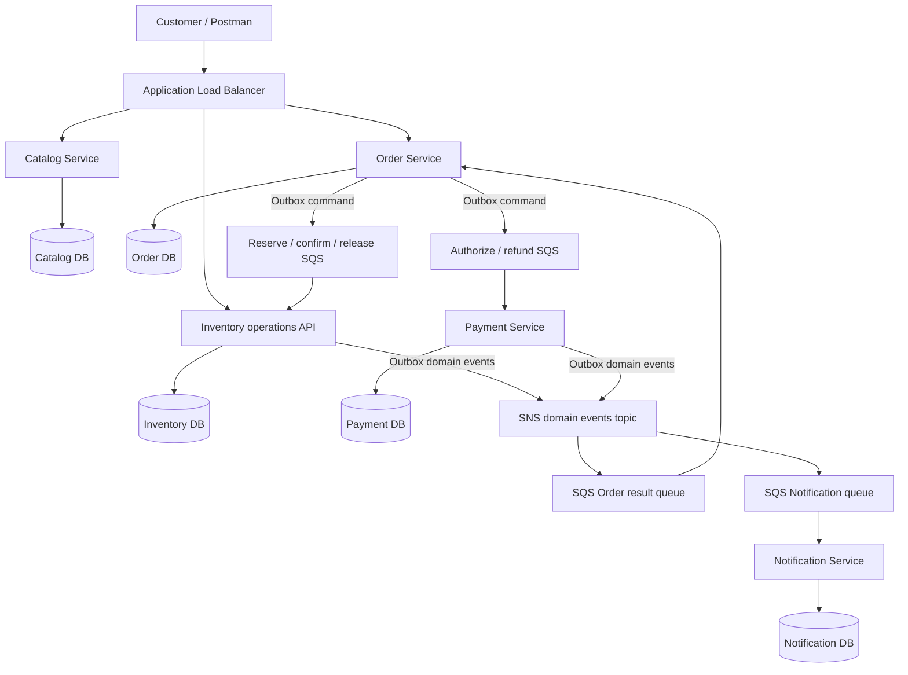
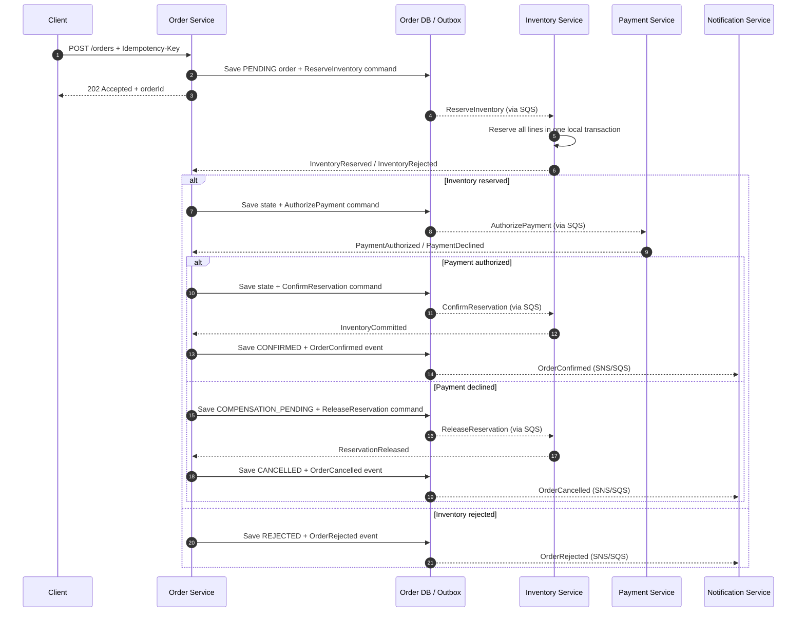
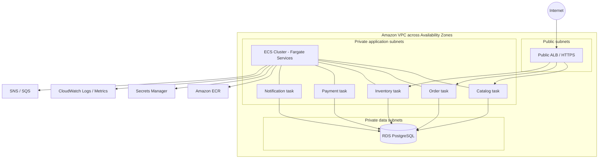

# FulfillX — Architecture and AWS Deployment

## 1. Logical architecture



## 2. Order workflow sequence



## 3. Messaging topology

Recommended first-release pattern:

- SQS command queues for Inventory commands and Payment commands.
- One SNS domain-event topic for service-produced facts.
- SQS subscriptions for each consumer (Order results, Notification events).
- A dead-letter queue for every source queue, with a configured redrive policy.
- Standard queues are acceptable for Release 1; assume at-least-once delivery and duplicates. Choose FIFO only if an explicit ordering requirement is identified and its deduplication/grouping behaviour is designed.

Each producer writes the business state change and outbox row in the same local DB transaction. An outbox publisher later sends to SNS/SQS and marks the row published. A crash after publish but before marking may cause a duplicate; consumers must deduplicate via a unique message ID and transactional inbox record.

## 4. AWS deployment topology



### AWS services

- **VPC:** public ingress subnets and private application/data subnets; use at least two Availability Zones for the production-style topology.
- **Application Load Balancer:** HTTPS entry point, listener rules/path routing, health checks.
- **ECS Fargate:** one ECS service/task definition per microservice; independent image, CPU/memory, desired count, health checks, and deployment configuration.
- **ECR:** private container repositories for each service.
- **RDS for PostgreSQL:** private subnet group, encrypted storage, backups, security-group ingress only from application tasks.
- **SNS/SQS:** asynchronous commands/events and dead-letter queues.
- **Secrets Manager:** database credentials and any provider secrets.
- **IAM:** separate task-execution and application task roles; least privilege.
- **CloudWatch:** logs, metrics, dashboards and alarms.
- **Cognito:** hosted OIDC identity provider for AWS deployment.
- **ACM / Route 53:** optional TLS certificate and custom DNS.

### Network security

- ALB security group accepts HTTPS from the internet.
- Service task security groups accept application ports only from the ALB security group when a service is exposed through the ALB; internal consumers need only the required outbound/network paths.
- RDS security group accepts PostgreSQL only from the relevant application task security groups.
- No public RDS endpoint.
- Prefer private Fargate subnets in the production profile. NAT gateways and interface VPC endpoints have ongoing costs; document the selected egress approach and its cost. A temporary demo topology may use a carefully restricted alternative, but do not weaken the database boundary.

### Identity and secrets

- Use an ECS task role for application access to SQS/SNS and other AWS APIs.
- Use a separate task-execution role for image pulls, log delivery, and secret injection as required by ECS.
- Do not embed static AWS keys in task definitions or application configuration.
- Inject secrets at runtime from Secrets Manager and rotate them where practical.

### Deployment safety

- Configure ECS health checks and deployment circuit breaker/rollback for rolling deployments.
- A deployment is not complete merely because an image was pushed: verify target health, service steady state, health endpoints, and a smoke test.
- Keep previous image digests available for rollback.
- Use GitHub Actions OIDC to assume a narrowly scoped AWS role; do not store long-lived IAM user access keys in GitHub secrets.

## 5. Cost-conscious portfolio profile

AWS resources incur charges even when a demo is not being actively viewed. Particularly review Fargate task runtime, ALB hours/LCUs, RDS instance/storage/backups, NAT gateways, and interface endpoints.

For a learning/demo environment:

- Run local development with Docker Compose by default.
- Deploy only when you need a live demonstration.
- Use the smallest supported task/database sizing that passes tests.
- Start with one task per service and a single-AZ database only if you clearly label it as a non-HA demo environment.
- Avoid NAT/VPC endpoint duplication across experimental environments; price the chosen network egress approach first.
- Add a documented cleanup command and run `terraform destroy` only after reviewing the plan and confirming data is disposable.
- Do not put a credit card or real payment data into the demo.

Never promise an exact monthly cost without calculating it for the selected AWS Region, resource sizes, traffic, and runtime using the current AWS Pricing Calculator.

## 6. Local development topology

Use Docker Compose for dependencies:

- PostgreSQL (separate DBs/users per service for local isolation).
- LocalStack for SNS/SQS integration during local development and integration tests.
- Keycloak optional for local OIDC login; production AWS deployment uses Cognito.
- Mailpit (or a log sink) for notification testing.

Spring services should still run as normal Java processes from the IDE, or as containers when testing the full environment. Provide `.env.example` with non-secret local defaults only.

## 7. Infrastructure-as-code structure

Suggested Terraform layout:

```text
infrastructure/terraform/
├── environments/
│   ├── dev/
│   └── demo/
└── modules/
    ├── network/
    ├── security/
    ├── messaging/
    ├── database/
    ├── ecs-service/
    ├── observability/
    └── identity/
```

Use remote state with encryption/versioning and locking appropriate to the selected Terraform version/backend. Separate environment configuration from reusable modules. Never commit tfstate, secret values, or private credentials.

## 8. CI/CD pipeline

Pull request:
1. Checkout and set up the selected JDK/Maven.
2. Run formatting/static checks if configured.
3. Run unit and integration tests.
4. Build each service image.
5. Run dependency and container vulnerability scans.

Main branch / release:
1. Repeat test and security gates.
2. Build immutable images and tag with commit SHA.
3. Authenticate to AWS using GitHub OIDC.
4. Push images to ECR.
5. Update ECS task definitions/services.
6. Wait for deployment stability and run smoke tests.
7. Report deployed commit, image digest, and environment URL.

Do not allow pull requests from untrusted forks to obtain production deployment permissions.
